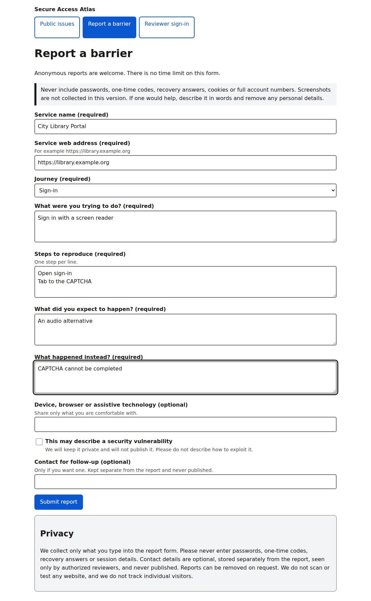
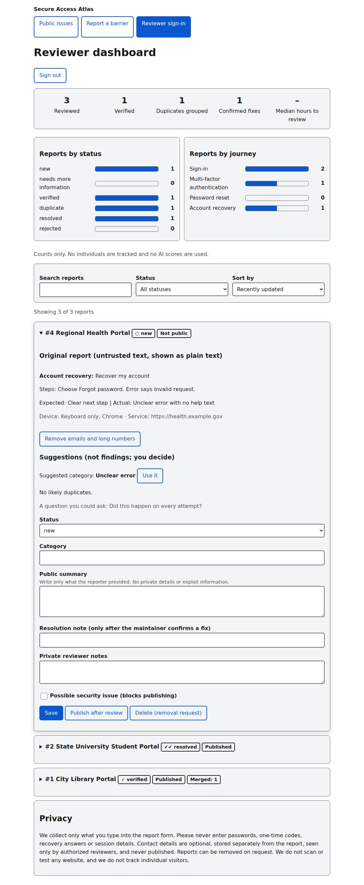
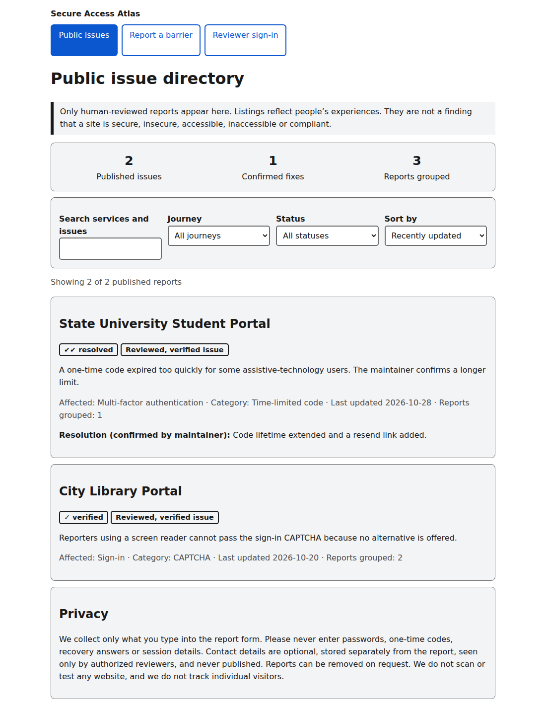
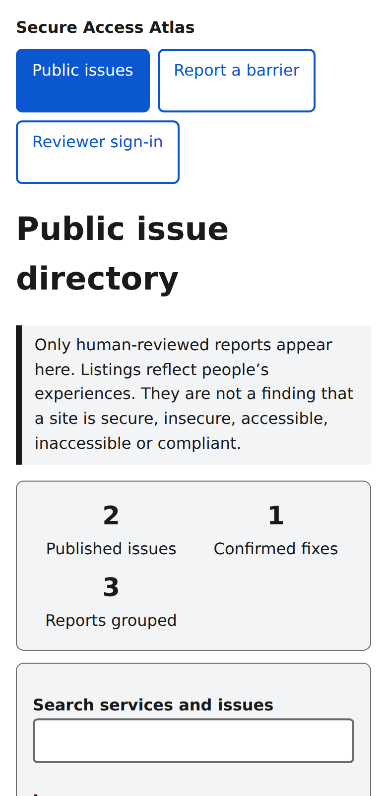
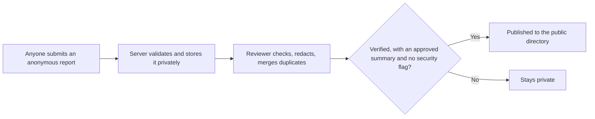

# Secure Access Atlas

**A privacy-first way to report, review and fix the barriers people meet when signing in to, or recovering, accounts on public-service websites.**

A login page can lock people out: a CAPTCHA a screen reader can't read, a one-time code that expires before a switch user can type it, an account-recovery error that explains nothing. Secure Access Atlas gives people a safe place to say so, and gives website teams clear, reproducible reports they can act on.

> Built for people with disabilities first, and never collects the things attackers want: no passwords, no one-time codes, no recovery answers, no session data.

---

## Screenshots

### Report a barrier and review reports

<p align="center">
  <a href="files/report-form.png"></a>
  <a href="files/reviewer-dashboard.png"></a>
</p>

### Public directory and mobile view

<p align="center">
  <a href="files/directory.png"></a>
  <a href="files/mobile.png"></a>
</p>

## How it works



Nothing is published automatically. A person decides every time.

## Who it serves

| Audience | What they get |
|---|---|
| **Reporters** | A short, accessible form. No account, no diagnosis, no time limit. Contact details are optional. |
| **Reviewers / maintainers** | A dashboard to triage, redact, merge duplicates, add private notes and decide what is safe to publish. |
| **The public** | A searchable directory showing which reports were reviewed, their status and any confirmed fix. |

## Features

- **Anonymous reporting** for sign-in, multi-factor authentication, password reset and account recovery
- **Private security path:** a flag keeps a possible vulnerability out of public view
- **Reviewer dashboard:** six statuses, redaction helper, duplicate merge that preserves every submission, private notes, manual publishing, deletion for removal requests
- **Public directory** with search, journey and status filters, sorting, and a clear difference between a *single user report* and a *reviewed, verified issue*
- **Impact measures without tracking people:** counts by status and journey, duplicates grouped, confirmed fixes, median hours to review
- **Live updates:** the reviewer page offers a refresh banner when new reports arrive; the public directory refreshes itself
- **Human-in-the-loop suggestions:** category and duplicate hints are computed locally with simple rules. No external AI service sees any report.

## Accessibility

- Works with keyboard only, with visible focus and a skip link
- Labelled form fields, plain-language errors, announcements for screen readers
- Status is shown with text and a symbol, never colour alone
- Light and dark themes, responsive layout, respects reduced-motion settings

## Quick start

Requires **Node.js 20 or newer**. There is nothing to install: no third-party dependencies.

```bash
git clone https://github.com/rohan667/secure-access-atlas.git
cd secure-access-atlas
REVIEWER_PASSWORD="a-long-private-passphrase" npm start
```

Open <http://127.0.0.1:3000>, then use **Reviewer sign-in** with that password. On Windows PowerShell:

```powershell
$env:REVIEWER_PASSWORD="a-long-private-passphrase"; npm start
```

Run the tests:

```bash
npm test
```

On first start the app creates a `data/` folder with fictional sample reports. Set `SEED_SAMPLE_DATA=0` to start empty.

## Security and privacy design

| Risk | How it is handled |
|---|---|
| Publishing something unsafe | The **server** refuses to publish unless a report is verified or resolved, has a reviewed summary and carries no security flag |
| Unauthorized reviewer access | Constant-time password check, HttpOnly + SameSite=Strict session cookie, CSRF token on every change |
| Cross-site scripting | Strict Content Security Policy with no inline scripts; all report text is rendered as plain text |
| Injection and oversized input | Strict validation, length limits, 20 KB request cap, JSON only |
| Spam and brute force | Rate limits on report submission and sign-in |
| Leaking contact details | Stored in a separate file, visible only to signed-in reviewers, never in public responses |
| Path traversal | Only whitelisted file types are served from `public/` |
| Scanning third-party sites | **Not done, by design.** Reports are people's experiences, not permission to test a site. |

Never collected: passwords, one-time codes, recovery answers, cookies, session tokens, or anything from a signed-in account.

## Configuration

| Variable | Purpose | Default |
|---|---|---|
| `REVIEWER_PASSWORD` | Reviewer sign-in password | random, printed at start |
| `PORT` / `HOST` | Where the server listens | `3000` / `127.0.0.1` |
| `COOKIE_SECURE` | Set to `1` when served over HTTPS | `0` |
| `TRUST_PROXY` | Set to `1` only behind a proxy you control | `0` |
| `SEED_SAMPLE_DATA` | Set to `0` for an empty start | `1` |
| `DATA_DIR` | Where report files are stored | `./data` |

See `.env.example`. Never commit real passwords; `.env` and `data/` are already git-ignored.

## API overview

| Route | Access | Purpose |
|---|---|---|
| `GET /api/public` | public | Published, reviewed reports only |
| `POST /api/reports` | public, rate-limited | Submit a report |
| `POST /api/login`, `/api/logout` | reviewer | Start or end a session |
| `GET /api/reviewer/reports` | reviewer | All reports, suggestions and metrics |
| `PATCH /api/reviewer/reports/:id` | reviewer | Edit, change status, redact, publish |
| `POST /api/reviewer/reports/:id/merge` | reviewer | Merge a duplicate |
| `DELETE /api/reviewer/reports/:id` | reviewer | Remove a report and its contact details |

## Project structure

```
server.js        HTTP server, API, validation, auth, rate limits
test.js          Automated tests (node:test)
public/          Front end: index.html, app.js, style.css
files/           README screenshots and related project files
LICENSE          MIT License
.env.example     Configuration template
```

## Honest limits

This is an MVP intended for a small pilot.

- One shared reviewer password: no per-person accounts or audit log yet
- Data is stored in local JSON files; move to a database before scaling
- Screenshots are not collected yet (they need malware scanning, metadata stripping and private storage first)
- Rate limiting is per process and held in memory
- No automatic data-retention job; use the delete action for removal requests
- Serve over HTTPS in production

## Roadmap

- [ ] Per-reviewer accounts with an audit log
- [ ] Database storage and a retention schedule
- [ ] Safe screenshot uploads
- [ ] Written threat model and privacy notice
- [ ] Pilot with one university, library or public-service team
- [ ] Optional, reviewer-approved AI drafting on redacted text only

## Contributing

Issues and pull requests are welcome. Please keep changes consistent with the project's rules: collect less data, publish nothing without human review, and never scan third-party sites.

## License

This project is licensed under the [MIT License](LICENSE).
